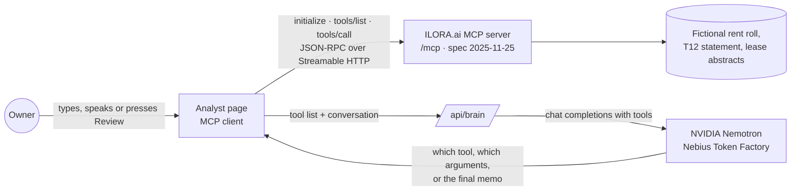

# ILORA.ai Building Analyst

**An AI analyst for the owner of a small commercial property portfolio. Press one button and NVIDIA Nemotron, running on Nebius Token Factory, checks every property and writes a memo of the money to collect and the leases to renew, each line traced to its source document, page and line.**

> **Review my portfolio**
>
> Money to collect: $18,690 across 3 items, largest first.
> 1. Coral Wren Plaza: $9,000 from Suite 104, whose lease shows a rent step in March that wasn't billed.
> 2. Tamarind Grove Apartments: $5,190 from Unit B-12, which shows occupied but has no rent posted for 2 months.
> 3. Coral Wren Plaza: $4,500 from a CAM reconciliation for Suite 108 posted to base rent.
>
> Leases to renew:
> - Tamarind Grove Apartments: 3 leases end within three months, $108,000 a year, 9% of rent roll income.

**Read this first, plainly:**
- **The model never produces a number.** Nemotron decides which check to run and writes the words. Every figure comes from a deterministic tool over an MCP server, and the tests assert each one to the dollar.
- **All data is fictional.** Coral Wren Plaza and Tamarind Grove Apartments, their tenants and every number are made up. The issues the review finds were built into the data on purpose.

## Why

An independent owner's rent roll says $412,000 a year. The income statement says $398,500. Nobody notices the $13,500 gap until a lender or a buyer does. Large firms pay analysts to tie these documents out every month; the owner of one strip center or one small apartment building does it alone, if at all.

## Run it locally in five minutes

Needs Node.js 20 or later.

```bash
git clone https://github.com/gSimani/ilora-building-analyst.git
cd ilora-building-analyst
npm install
npm run dev
```

Open http://localhost:8787. With no key, a rules-based planner stands in for the model, so the page and the tests run offline.

To use NVIDIA Nemotron on Nebius Token Factory, create an API key in [Token Factory](https://tokenfactory.nebius.com/) and start with:

```bash
BRAIN=nemotron NEBIUS_API_KEY=your-key npm start
```

Add `VOICE=polly` with AWS credentials to hear answers in an Amazon Polly generative voice; otherwise the browser voice reads them. The header of every answer names the model that wrote it.

Run the tests:

```bash
npm test
```

## How it works



1. The page connects to the MCP server and lists its five tools.
2. Each step, the page sends the conversation and the tool list to `/api/brain`. The server passes them to Nemotron as function definitions through Token Factory's chat-completions endpoint.
3. Nemotron returns a tool call. The page runs it over MCP and sends the structured result back.
4. When Nemotron has what it needs, it writes the answer. A question takes one or two steps; a portfolio review takes eight.

**Two Nemotron sizes.** Ordinary questions go to the newest Nemotron Nano listed for the key, so answers stay quick and cheap. The portfolio review goes to the newest Nemotron Super, which plans the full sequence of checks and writes the memo. Both are picked from `GET /v1/models` at startup and can be pinned with `NEMOTRON_FAST_MODEL` and `NEMOTRON_MODEL`. The code is in [src/assistant/nemotron.ts](src/assistant/nemotron.ts).

## The tools

One owner question per tool. Every tool declares an `outputSchema` and returns matching `structuredContent`. Errors come back with `isError` and a JSON body that offers alternatives.

| Tool | Owner asks | Returns |
|---|---|---|
| `list_properties` | "What properties do I have?" | id, name, type and city for each property |
| `get_property_snapshot` | "How is Coral Wren Plaza doing?" | occupancy, rent roll rent and statement rental income (trailing 12 months), NOI, open flag count, top flag |
| `check_rent_roll_vs_statement` | "Does my rent roll match my income statement?" | both totals, the gap, ranked causes with reason, fix and source document, page and line. Shown as a Card |
| `list_expiring_leases` | "Which leases expire in the next 90 days?" | leases ending in `months_ahead` with rent and share of income. Shown as a List |
| `explain_flag` | "Show me the lines" | every source citation and the suggested fix |

## The demo data

| Property | Type | What the review finds |
|---|---|---|
| Coral Wren Plaza, Delray Beach, FL | 12-suite neighborhood retail center | Rent roll $412,000 vs statement $398,500. Gap $13,500 = Suite 104's March rent step never billed ($9,000) + a CAM reconciliation credit posted to base rent ($4,500) |
| Tamarind Grove Apartments, Boynton Beach, FL | 48-unit garden apartments | 3 leases end within 90 days, 9.0% of rent roll income; Unit B-12 shows occupied with no rent posted for July and August ($5,190) |

Files per property in [data/](data/): `rent_roll.csv`, `t12_operating_statement.csv` (general-ledger detail with document, page and line), lease abstracts as JSON, and `property.json`. Regenerate with `npm run data`.

## Deploy

One AWS Lambda function with a function URL serves the page, the MCP endpoint and `/api/brain`; the model itself runs on Nebius Token Factory.

```bash
npm run build:lambda
sam deploy --guided --template-file template.yaml
```

Stack parameters: `Brain` (`nemotron` or `offline`), `NebiusApiKey`, `Voice` (`polly` or `browser`). `/api/brain` and `/api/speak` cap requests per hour per caller and in total, which bounds what a public URL can spend. Remove everything with `sam delete`.

## Project layout

```
src/assistant/nemotron.ts  Nemotron on Nebius Token Factory: tool calling, model choice, review prompt
src/assistant/planner.ts   Offline stand-in for the model, and the review memo it writes
src/assistant/routes.ts    /api/brain, /api/speak (Polly), /api/config
src/server.ts              MCP server and the five tools
src/domain.ts              The checks: reconciliation, expirations, flags, snapshot
src/ui.ts                  Card and List views (MCP Apps ui:// resources)
simulator/                 The analyst page
tests/                     Data, tools, golden conversation, Nemotron wiring, portfolio review
data/                      Fictional demo dataset
```

## What is new in this hackathon

This project builds on our earlier ILORA.ai MCP server (written October 19 to 23, 2026, inside this hackathon's submission period). Added for this entry:

- **NVIDIA Nemotron on Nebius Token Factory** as the model that chooses tools and writes answers, with Nano for questions and Super for the review.
- **The portfolio review**: one request runs every check on every property and returns a ranked memo that separates money to collect from leases to renew.
- **A natural voice**: Amazon Polly's generative engine replaces the earlier neural voice.
- The Amazon Bedrock integration was removed.

## License

[MIT](LICENSE), copyright Ilora AI, Inc.

The license covers this code. It does not grant any right to use the ILORA.ai name, logo or brand.
